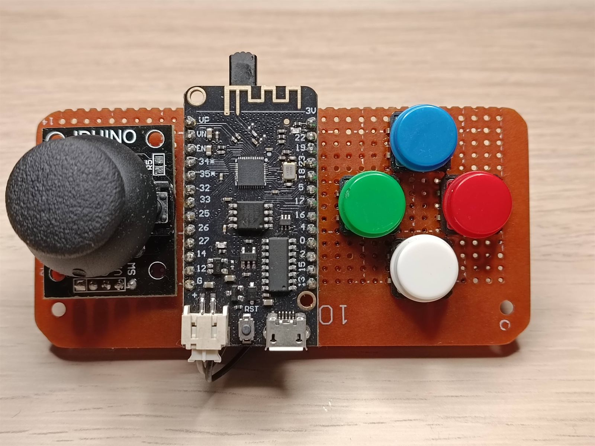
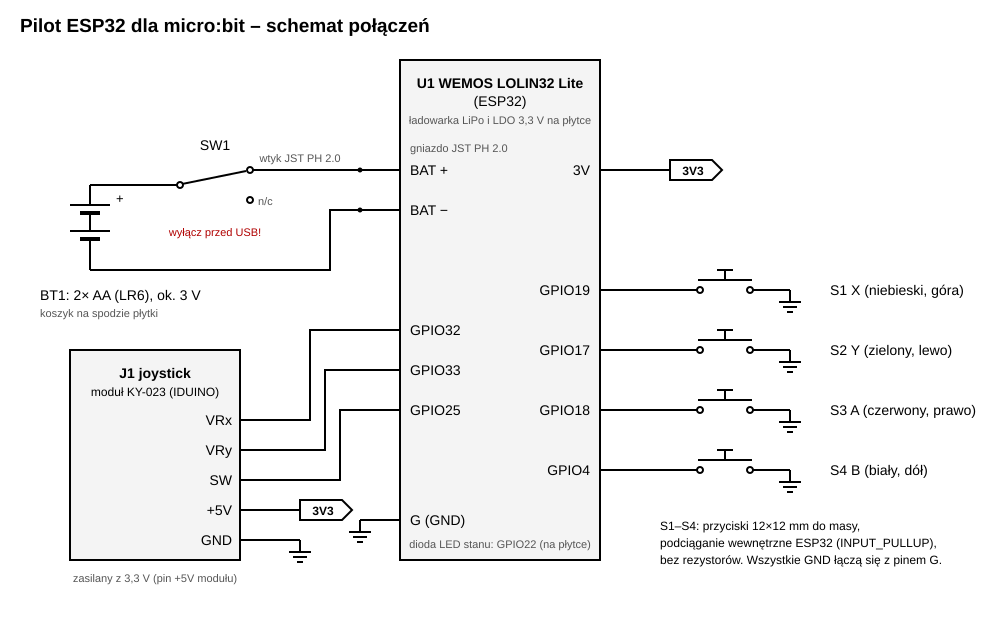

# esp32-radio-remote-for-microbit

Pilot do micro:bita na ESP32 (ESPHome), który mówi protokołem radia micro:bit.

ESP32 wysyła pakiety w formacie radia micro:bit, a micro:bit odbiera je
wbudowanymi blokami **Radio** w MakeCode. Nie trzeba parowania, adresu MAC ani rozszerzenia.
Ramka micro:bit jest schowana w danych zwykłej reklamy BLE („pakiet w pakiecie”)
nadawanej na jednym kanale reklamowym. Komponent steruje kontrolerem BLE bezpośrednio
przez VHCI, bez stosu Bluedroid/NimBLE.

Jedyna różnica dla ucznia: oprócz `radio.setGroup()` potrzebny jest blok
`radio.setFrequencyBand(2)` (Radio → więcej).



## Sprzęt

WEMOS LOLIN32 Lite, joystick KY-023, cztery przyciski 12×12 mm i dwie baterie AA na płytce uniwersalnej.
Zdjęcia, lista zakupów, schemat i tabela połączeń są w [docs/budowa.md](docs/budowa.md).



## Pliki

| Plik | Co to jest |
|---|---|
| `components/microbit_radio/` | komponent zewnętrzny ESPHome |
| `microbit-radio-remote.yaml` | firmware testowy (piny jak w `bt-microbit-remote.yaml`) |
| `docs/` | budowa pilota: zdjęcia, lista zakupów, schemat |
| `makecode-test.ts` | program testowy dla micro:bita (tylko wbudowane bloki) |
| `microbit-radio-encoder.mjs` | koder referencyjny i symulowany odbiornik nRF (`node microbit-radio-encoder.mjs`) |
| `test-frame-header.mjs` | sprawdza logikę `microbit_frame.h` bez kompilatora C++ (`node test-frame-header.mjs`) |
| `gen-vectors.mjs` | generuje wektory do autotestu w `microbit_frame.h` |

## Użycie w ESPHome

ESPHome pobiera komponent prosto z tego repozytorium, więc nie trzeba niczego kopiować:

```yaml
external_components:
  - source: github://sargo/esp32-radio-remote-for-microbit@main
    components: [microbit_radio]
    refresh: 0s     # na czas testów: zawsze najnowsza wersja

microbit_radio:
  id: mb_radio
  group: 1          # radio.setGroup(1)
  ble_channel: 37   # 37 -> band 2, 38 -> band 26, 39 -> band 80
  interval: 100ms   # odstęp reklam BLE
  repeat: 1         # ile kopii każdej wiadomości odbierze micro:bit
```

Wysyłanie z lambd:

```cpp
id(mb_radio).send_number(42);        // radio.onReceivedNumber
id(mb_radio).send_value("A", 1);     // radio.onReceivedValue, nazwa do 5 znaków
id(mb_radio).send_string("hello");   // radio.onReceivedString, do 9 znaków
id(mb_radio).set_group(3);           // dotyczy kolejnych wiadomości
```

## Test krok po kroku

1. Wgraj firmware: `esphome run microbit-radio-remote.yaml`.
   W logu powinny się pojawić:
   - `Frame encoder self-test OK`
   - `Ready: group 1, micro:bit frequency band 2`
   - co 2 s `Send number N`
2. Na micro:bicie wklej `makecode-test.ts` w zakładce JavaScript na makecode.microbit.org i wgraj program.
3. Oczekiwany efekt:
   - co 2 s micro:bit pokazuje kolejną cyfrę 0–9,
   - wciśnięcie przycisku pilota pokazuje literę (A, B, X, Y, C, N, S, E, W), a puszczenie czyści ekran.
4. Straty pakietów: przycisk A na micro:bicie pokazuje, ile cyfr dotarło. Porównaj tę liczbę z liczbą `Send number` w logu ESP32.

## Gdy nic nie dochodzi

- Sprawdź, czy grupa i band są takie same po obu stronach.
- Spróbuj `ble_channel: 39` i `radio.setFrequencyBand(80)`. Kanał 37 (2402 MHz) leży na skraju kanału 1 Wi-Fi.
- Sprawdź w logu ESP32 błędy `status 0x..` z komend HCI.
- Jeśli dochodzi tylko część pakietów, ustaw `repeat: 2` (micro:bit dostanie wtedy kopie) albo `interval` dłuższy niż 100 ms.
- Drugi micro:bit wysyłający `radio.sendNumber()` na tej samej grupie i tym samym bandzie potwierdzi, że odbiornik działa.

## Ograniczenia i rzeczy niesprawdzone na sprzęcie

- Pakiet musi się zmieścić w 31 bajtach reklamy: liczby całkowite (int32), nazwa wartości do 5 znaków, tekst do 9 znaków.
- Działa tylko w jedną stronę (ESP32 → micro:bit).
- Nie łącz z `esp32_ble`, `esp32_ble_tracker`, `ble_client` ani `bluetooth_proxy`, bo używają tego samego kontrolera.
- Wi-Fi razem z tym komponentem nie było testowane.
- Bez sprzętu nie dało się sprawdzić:
  - kolejności bitów CRC w radiu Nordic (przyjęta według dokumentacji Nordic),
  - tolerancji dewiacji (BLE ±250 kHz, micro:bit ok. ±170 kHz),
  - czasu od włączenia reklamy do pierwszego pakietu (okno nadawania to połowa `interval`).

## Źródła

- Format ramki: [codal-microbit-v2 `MicroBitRadio.cpp`](https://github.com/lancaster-university/codal-microbit-v2/blob/master/source/MicroBitRadio.cpp)
  i [pxt-common-packages `radio.ts`](https://github.com/microsoft/pxt-common-packages/blob/master/libs/radio/radio.ts).
- Symulowany odbiornik w `microbit-radio-encoder.mjs` używa funkcji whiteningu przeniesionej z biblioteki
  ESPeranto ([woot2023_espwn32_artifacts](https://github.com/RCayre/woot2023_espwn32_artifacts),
  licencja MIT, © 2023 Romain Cayre, Damien Cauquil, Aurélien Francillon).
