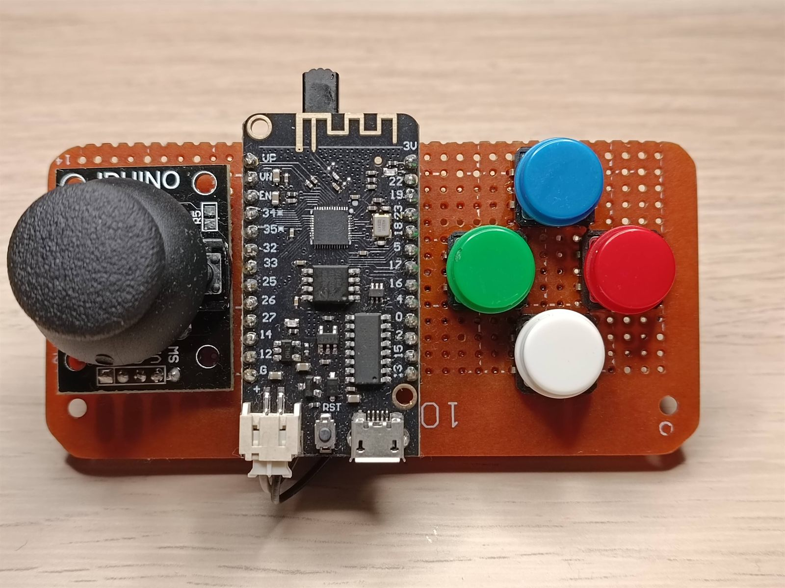
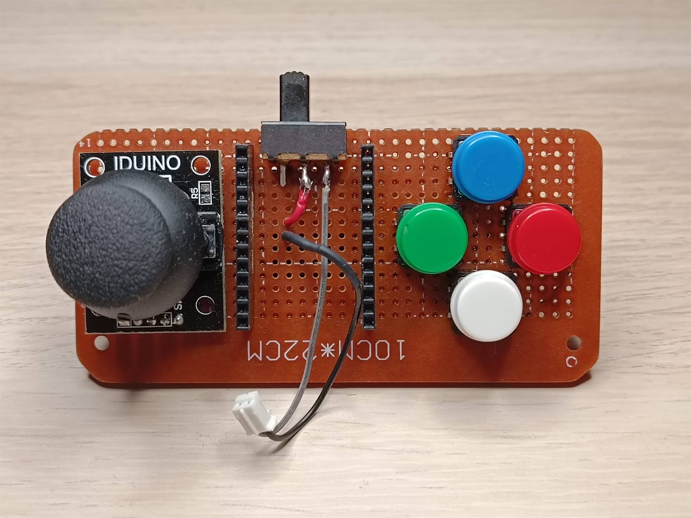
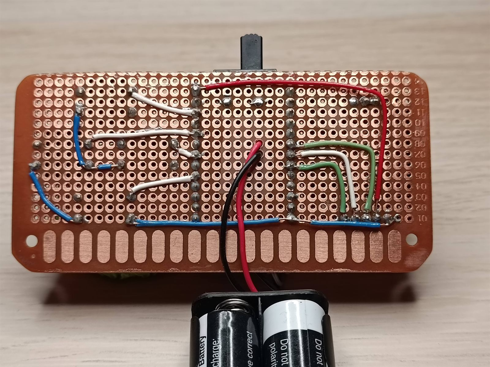
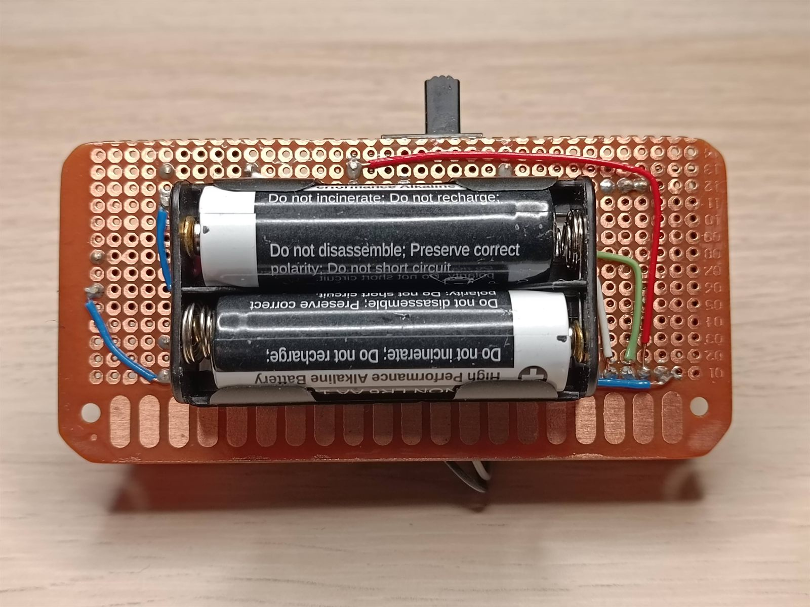
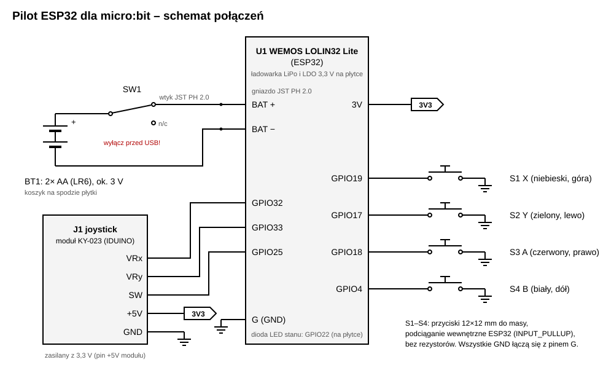

# Budowa pilota

Pilot to płytka uniwersalna z modułem ESP32 (WEMOS LOLIN32 Lite) w gniazdach,
modułem joysticka, czterema przyciskami i zasilaniem z dwóch baterii AA.
Nie ma tu żadnych rezystorów: przyciski zwierają piny do masy, a podciąganie
zapewnia sam ESP32 (`INPUT_PULLUP` w [`microbit-radio-remote.yaml`](../microbit-radio-remote.yaml)).

| Od przodu | Od przodu, bez ESP32 |
|---|---|
|  |  |

| Spód: połączenia | Spód: koszyk na baterie |
|---|---|
|  |  |

Zdjęcia spodu są lustrzanym odbiciem przodu: joystick jest tam po prawej, a przyciski po lewej.

## Lista zakupów

| # | Element | Ilość | Uwagi |
|---|---|---|---|
| 1 | WEMOS LOLIN32 Lite (ESP32) | 1 | Z gniazdem baterii JST PH 2.0, ładowarką LiPo i micro-USB. Klony „ESP32 Lite” mają ten sam układ pinów: VP…G po jednej stronie, 3V…13 po drugiej. |
| 2 | Moduł joysticka 2-osiowego z przyciskiem (KY-023 lub podobny, tu IDUINO) | 1 | Wyprowadzenia GND, +5V, VRx, VRy, SW. Działa z 3,3 V. |
| 3 | Przycisk tact switch 12×12 mm, THT, 4 nóżki | 4 | Z okrągłymi nasadkami: niebieską, zieloną, czerwoną i białą. |
| 4 | Przełącznik suwakowy SPDT (1P2T), 3 nóżki, do druku | 1 | Włącznik zasilania. Używane są dwie nóżki. |
| 5 | Koszyk na 2 baterie AA z przewodami | 1 | Przymocowany do spodu płytki. |
| 6 | Baterie AA alkaliczne (LR6) | 2 | Zobacz [Zasilanie](#zasilanie). |
| 7 | Wtyk JST PH 2.0, 2 piny, z przewodami | 1 | Do gniazda baterii w LOLIN32 Lite. Sprawdź biegunowość. |
| 8 | Listwa żeńska (goldpin) 1×13, raster 2,54 mm | 2 | Albo listwa 1×40 przycięta na dwie części. Rzędy są 9 oczek od siebie (22,86 mm). |
| 9 | Płytka uniwersalna jednostronna, raster 2,54 mm | 1 | Pole ok. 37 × 14 oczek, czyli ok. 10 × 5 cm. |
| 10 | Cienki przewód w izolacji, kilka kolorów (AWG 26–30) | ok. 1 m | Na połączenia od spodu. |

Opcjonalnie:
- akumulator LiPo 1S 3,7 V z wtykiem JST PH 2.0 zamiast baterii AA,
- taśma dwustronna do przyklejenia koszyka.

Narzędzia: lutownica, cyna, obcinaczki, multimetr.

## Schemat

| Element | Wyprowadzenie | Pin LOLIN32 Lite | Komunikat radiowy |
|---|---|---|---|
| Joystick | GND | G | |
| Joystick | +5V | 3V (3,3 V) | |
| Joystick | VRx | 32 | `N` / `S` |
| Joystick | VRy | 33 | `E` / `W` |
| Joystick | SW (wciśnięcie) | 25 | `C` |
| Przycisk X, niebieski, góra | jeden styk | 19 | `X` |
| Przycisk Y, zielony, lewo | jeden styk | 17 | `Y` |
| Przycisk A, czerwony, prawo | jeden styk | 18 | `A` |
| Przycisk B, biały, dół | jeden styk | 4 | `B` |
| Przyciski X/Y/A/B | drugi styk | G | |
| Przełącznik SW1 | środkowa nóżka | + koszyka | |
| Przełącznik SW1 | skrajna nóżka | + wtyku JST | |
| Koszyk | − | − wtyku JST | |
| Dioda LED stanu | | 22 | na płytce, świeci stanem niskim |

Układ przycisków jest taki jak w padach Nintendo: X na górze, Y po lewej, A po prawej, B na dole.

## Zasilanie

- Wtyk JST z koszyka wchodzi do gniazda baterii w LOLIN32 Lite. Włącznik SW1 przerywa przewód plusowy.
- **Wyłącz SW1 przed podłączeniem USB.** LOLIN32 Lite ma ładowarkę LiPo na gnieździe baterii. Przy włączonym SW1 i podłączonym USB próbowałaby ładować baterie alkaliczne, a te mogą się wtedy nagrzać albo wylać.
- Dwie baterie AA dają ok. 3 V. To blisko dolnej granicy dla ESP32, więc przy rozładowanych bateriach płytka zacznie się resetować.
- Lepsza opcja to akumulator LiPo 3,7 V z wtykiem JST PH 2.0. Ładuje się wtedy z USB, a SW1 może zostać włączony.
- Biegunowość wtyków JST PH bywa różna. Przed podłączeniem sprawdź, czy przewód plusowy trafia do pinu oznaczonego „+” na LOLIN32 Lite.

## Wskazówki do montażu

- LOLIN32 Lite siedzi w dwóch listwach żeńskich, więc można go wyjąć do programowania.
- Antena modułu (zygzak na górze) wystaje poza krawędź płytki. Dzięki temu pod anteną nie ma miedzi, co poprawia zasięg.
- Joystick jest zasilany z pinu 3V, nie z 5 V. Dzięki temu napięcia na VRx/VRy mieszczą się w zakresie przetwornika ADC w ESP32.
- W oryginale masa przycisków biegnie przez ich nóżki. W przycisku 12×12 mm nóżki oddalone o 12,5 mm są połączone wewnętrznie, a nóżki oddalone o 5 mm są przełączane. Przed lutowaniem sprawdź to multimetrem.
- Połączenia na zdjęciach biegną od spodu: biały przewód dla każdego przycisku, dwa zielone i biały do joysticka (VRx, SW, VRy), czerwony do 3V oraz niebieska magistrala masy wzdłuż dolnej krawędzi.
