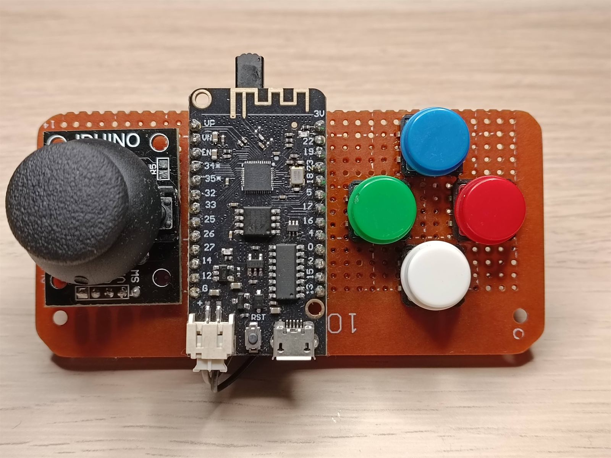
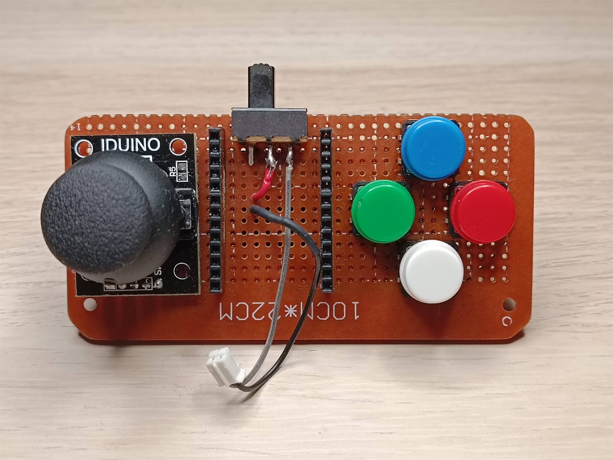
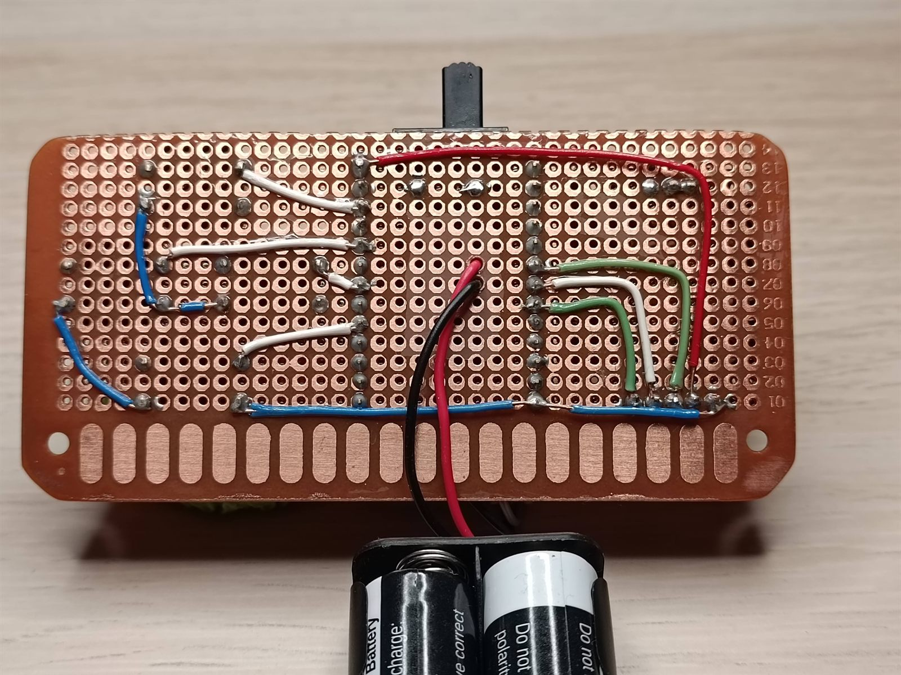
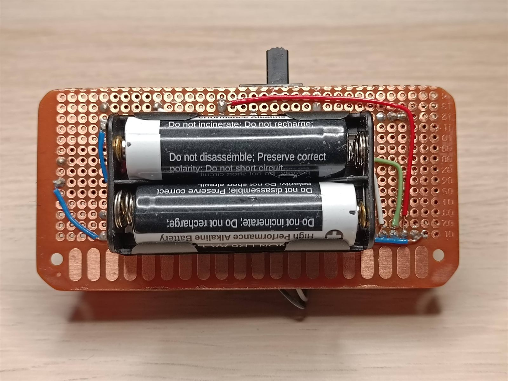
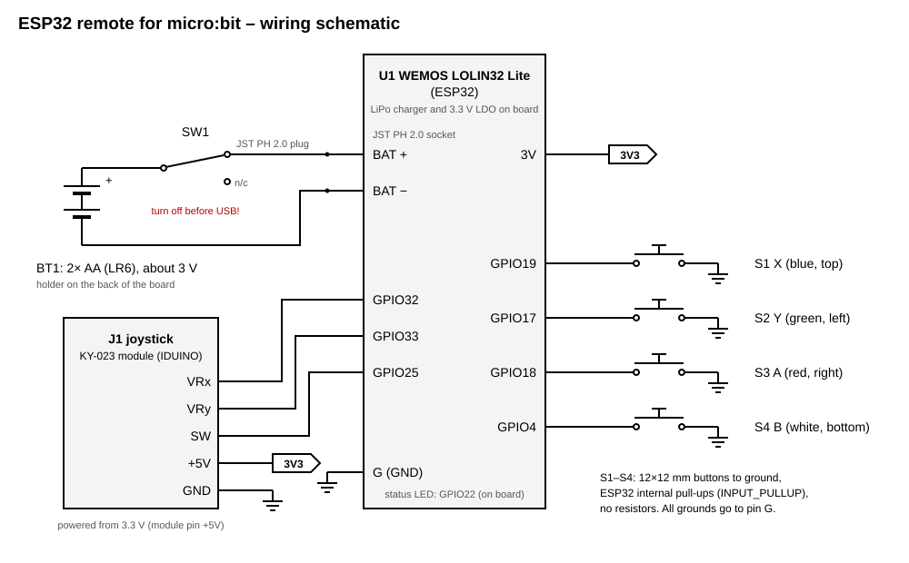

# Building the remote

The remote is a perfboard with an ESP32 module (WEMOS LOLIN32 Lite) in sockets,
a joystick module, four buttons and a two-AA battery pack.
There are no resistors: the buttons pull pins to ground, and the pull-ups are the
ESP32's own (`INPUT_PULLUP` in [`microbit-radio-remote.yaml`](../microbit-radio-remote.yaml)).

| Front | Front, without the ESP32 |
|---|---|
|  |  |

| Back: wiring | Back: battery holder |
|---|---|
|  |  |

The photos of the back are a mirror image of the front: the joystick is on the right there and the buttons on the left.

## Parts list

| # | Part | Qty | Notes |
|---|---|---|---|
| 1 | WEMOS LOLIN32 Lite (ESP32) | 1 | With a JST PH 2.0 battery socket, LiPo charger and micro-USB. "ESP32 Lite" clones have the same pinout: VP…G on one side, 3V…13 on the other. |
| 2 | 2-axis joystick module with push button (KY-023 or similar, IDUINO here) | 1 | Pins GND, +5V, VRx, VRy, SW. Works at 3.3 V. |
| 3 | Tactile switch 12×12 mm, through-hole, 4 legs | 4 | With round caps: blue, green, red and white. |
| 4 | Slide switch SPDT (1P2T), 3 legs, PCB mount | 1 | Power switch. Two of the legs are used. |
| 5 | 2×AA battery holder with leads | 1 | Fixed to the back of the board. |
| 6 | AA alkaline batteries (LR6) | 2 | See [Power](#power). |
| 7 | JST PH 2.0 plug, 2 pins, with leads | 1 | Goes into the LOLIN32 Lite battery socket. Check the polarity. |
| 8 | Female pin header 1×13, 2.54 mm pitch | 2 | Or a 1×40 header cut in two. The rows are 9 holes apart (22.86 mm). |
| 9 | Single-sided perfboard, 2.54 mm pitch | 1 | About 37 × 14 holes, roughly 10 × 5 cm. |
| 10 | Thin insulated hook-up wire, a few colours (AWG 26–30) | about 1 m | For the wiring on the back. |

Optional:
- a 1S 3.7 V LiPo battery with a JST PH 2.0 plug instead of the AA batteries,
- double-sided tape for the battery holder.

Tools: soldering iron, solder, side cutters, multimeter.

## Schematic

| Part | Pin | LOLIN32 Lite pin | Radio message |
|---|---|---|---|
| Joystick | GND | G | |
| Joystick | +5V | 3V (3.3 V) | |
| Joystick | VRx | 32 | `N` / `S` |
| Joystick | VRy | 33 | `E` / `W` |
| Joystick | SW (press) | 25 | `C` |
| Button X, blue, top | one contact | 19 | `X` |
| Button Y, green, left | one contact | 17 | `Y` |
| Button A, red, right | one contact | 18 | `A` |
| Button B, white, bottom | one contact | 4 | `B` |
| Buttons X/Y/A/B | other contact | G | |
| Switch SW1 | middle leg | battery holder + | |
| Switch SW1 | outer leg | JST plug + | |
| Battery holder | − | JST plug − | |
| Status LED | | 22 | on the board, active low |

The button layout matches Nintendo controllers: X on top, Y on the left, A on the right, B at the bottom.

## Power

- The JST plug from the battery holder goes into the LOLIN32 Lite battery socket. Switch SW1 breaks the positive lead.
- **Turn SW1 off before plugging in USB.** The LOLIN32 Lite has a LiPo charger on its battery socket. With SW1 on and USB connected, it would try to charge the alkaline batteries, which can then heat up or leak.
- Two AA batteries give about 3 V. That is close to the lower limit for the ESP32, so the board starts resetting as the batteries run down.
- A 3.7 V LiPo battery with a JST PH 2.0 plug is the better option. It charges from USB, and SW1 can stay on.
- JST PH plugs come with either polarity. Before connecting, check that the positive lead goes to the pin marked "+" on the LOLIN32 Lite.

## Assembly notes

- The LOLIN32 Lite sits in two female headers, so it can be removed for programming.
- The module's antenna (the zigzag at the top) sticks out past the edge of the board. That keeps copper away from the antenna and improves range.
- The joystick is powered from the 3V pin, not from 5 V. That keeps the VRx/VRy voltages within the range of the ESP32's ADC.
- In the original build, the buttons' ground runs through their legs. On a 12×12 mm tactile switch, the legs 12.5 mm apart are connected internally and the legs 5 mm apart are switched. Check this with a multimeter before soldering.
- The wiring in the photos runs on the back: a white wire for each button, two green and one white wire to the joystick (VRx, SW, VRy), a red wire to 3V and a blue ground bus along the bottom edge.
